## 前言

尽管还没到年末，但也到了 2026 的购物节前夕。想着个人博客许久没更了，因此拿点东西出来凑个数，列一些 2026 年给我带来印象的能算成“产品”的东西。

免责声明：全文无广，但作者也不为产品好坏负责。

## 推荐

### 1. 小米 15

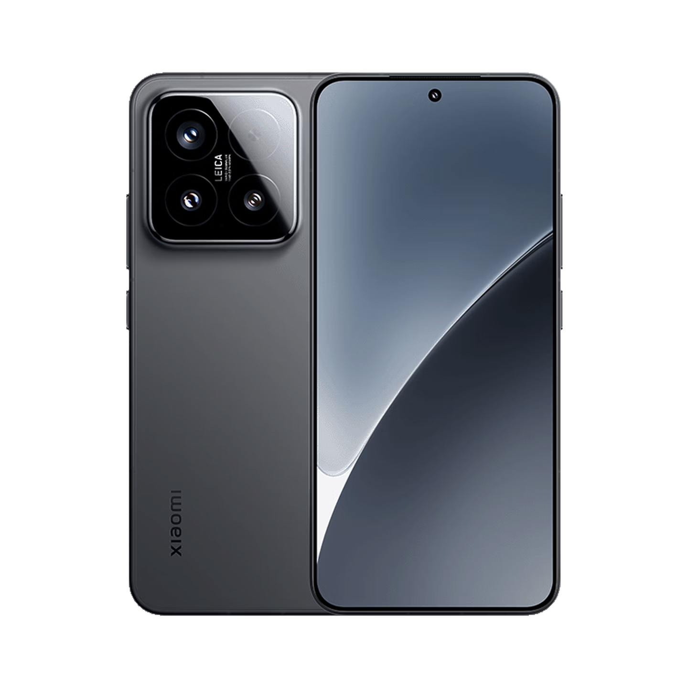

推荐：小米 15。价格参考：16GB + 512GB / 2800 元。

严格来说，小米 15 并不是我 2026 年买的产品。我是在 25 年的 618 用不到 3000 元买到的，没想到一年半后在内存暴涨的背景下其价格几乎没怎么下降。看看它的配置，骁龙 8 Elite 与 16GB + 512GB 的规格再用个两三年也没多大问题，拍照、屏幕等等素质都还算不错，应该能撑过这次数码行业的寒冬。这也可能是骁龙 8E 老机型的最后一波存货了。如果还想用不到 3000 元买到次旗舰级别的体验，这可能是最后的机会。

要说问题，确实也有。在动辄手机电池容量达到 8000、10000 毫安时的今天，小米 15 5400 毫安时的典型容量确实不太够看。但瑕不掩瑜，如果中短期内有换机需求，快囤一台吧。

### 2. 蜂蜜冻干柠檬片

推荐：蜂蜜冻干柠檬片。价格参考：200g / 20 元

“这白开水怎么没味儿啊”。——某著名醉酒 UP 主。

平时我一般喝的饮料是红茶、普洱，但每到晚上，喝茶饮还是太影响睡眠了。找来找去，发现了这种冻干柠檬片。既不会完全没有味道，也不至于太过甜腻，而且还非常好保存，甚至可以和非常多种类的饮料结合起来。冲泡使用热水凉水都行，只要不是太怕酸，我想这已经是比较理想的饮料形式了。

### 3. 米家空气净化器 2

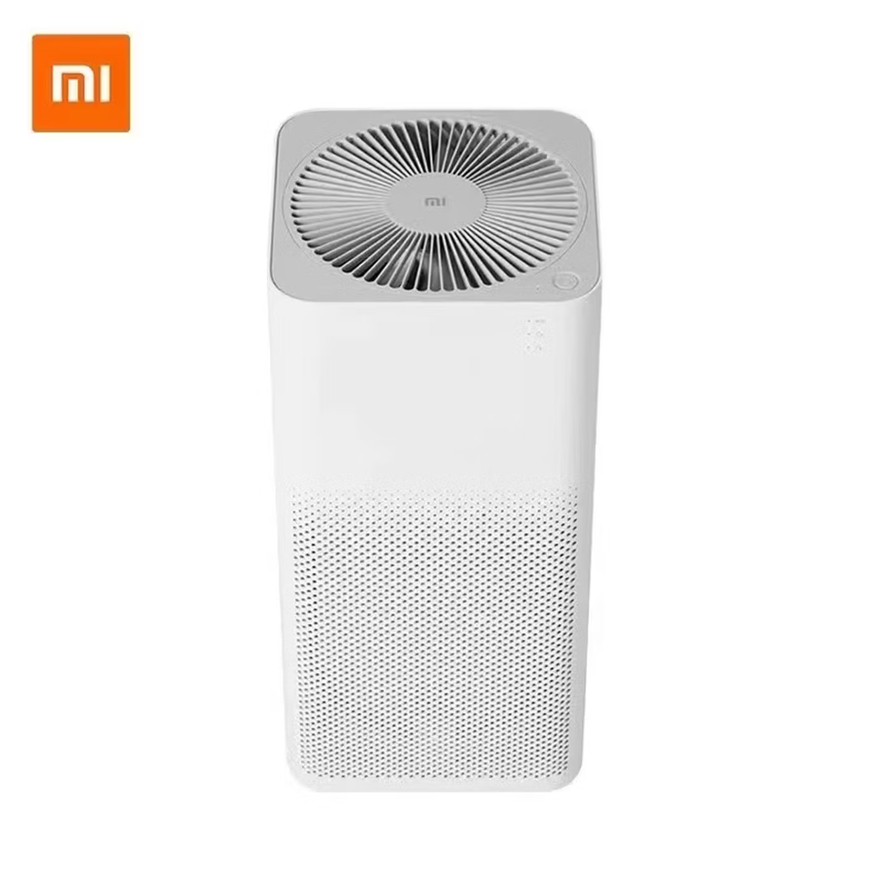

推荐：米家空气净化器 2。价格参考：80 元（二手、不带滤芯）

本来我买这个空气净化器是为了给屋里除尘。但用了一段时间，它对减少灰尘几乎没有效果。偶然间我发现可以把笔记本电脑放在上面，让空气净化器做一个大号散热器。不仅风量充足，还省去了积灰烦恼，声音也完全可以接受。原先常常发热降频的笔记本现在可以畅玩游戏了。

当然，这里仅推荐买它来做笔记本电脑散热器这一个用途。如果你想真正用上空气净化器原本的功能，那么完全有更多更好的选择，甚至可以自己买大功率风扇直接架在单买的滤芯上吸，效果也很不错。

### 4. 花椒油

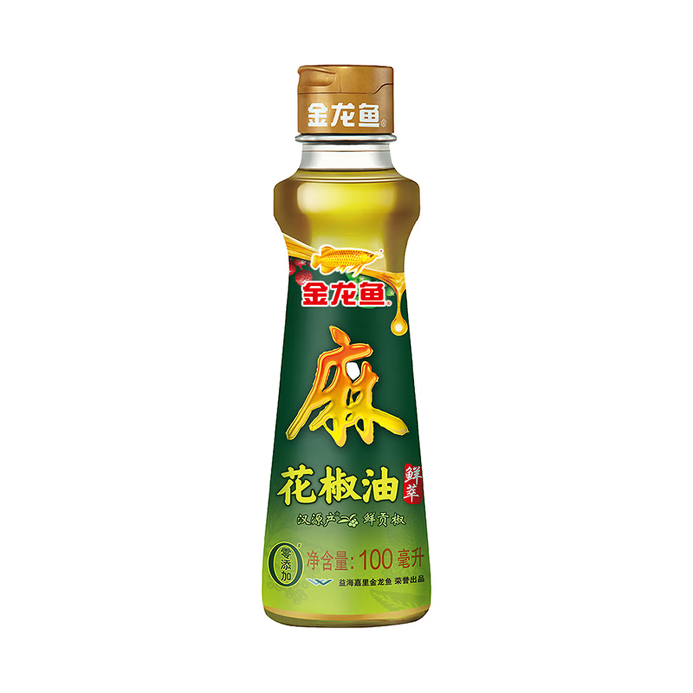

推荐：花椒油。价格参考：100ml / 6 元。

偶然间买的调料套装中有一小瓶花椒油，没想到意外地好吃。而且不仅是麻婆豆腐、拌凉菜这种常见的麻味菜肴能用到，即使在日常炒菜中，偏咸味、复杂味道的菜品也可以放一些进去增香，甚至你吃饺子的醋都可以滴一点进去，使用场景远比我原本想象中多。

### 5. 酷态科 6 号电能卡片 Air

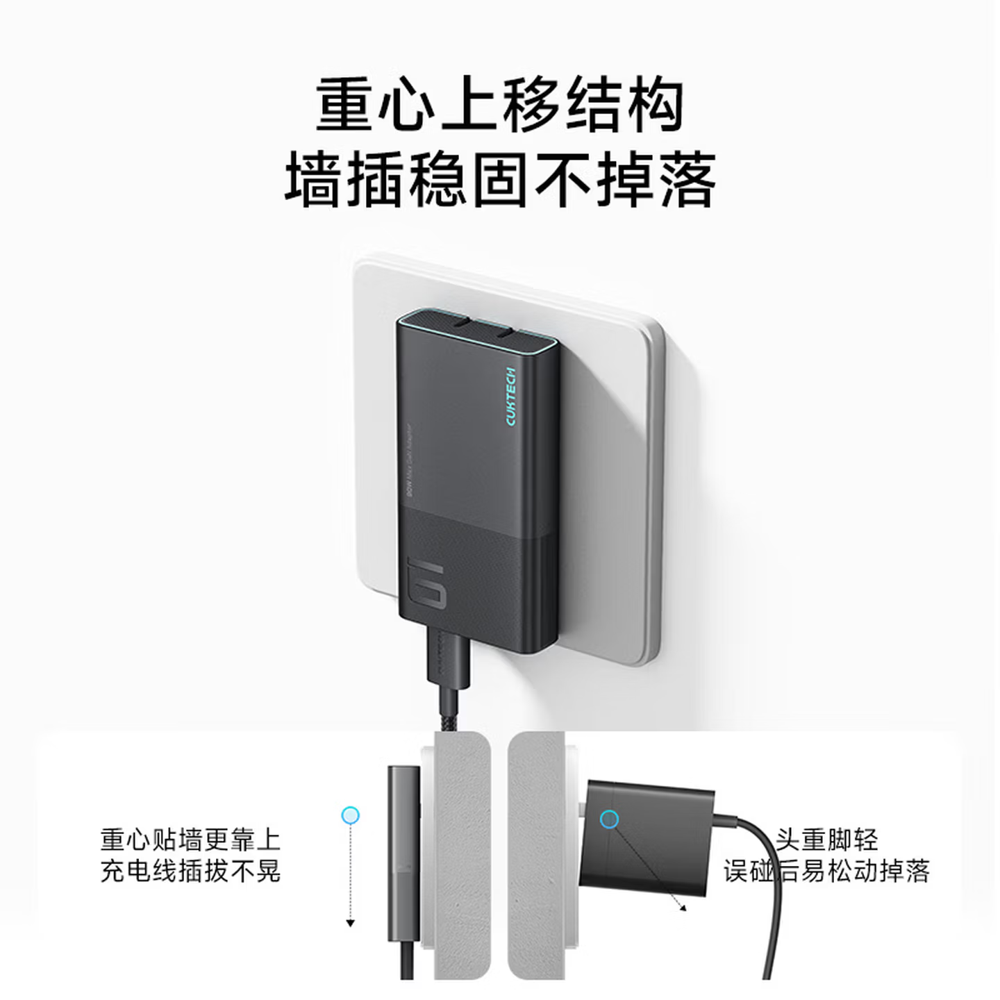

推荐：酷态科 6 号电能卡片 Air。价格参考：86 元。

本来我是盯上酷态科 CP6 的，机缘巧合买了这款，意外的好用。首先就是轻薄，旺旺仙贝的大小让它在“带出去”这件事上几乎无感。另外一点是尽管它的体积非常小，依然可以维持较长时间的高功率输出，发热也不算大。

### 6. 美国运通信用卡

推荐：美国运通信用卡

不知道是不是因为用得人少，运通信用卡的活动相比银联、VISA、万事达来说要好参加一些。运通权益里面有个精选餐厅权益，每月两次机会可以抢一张 150 无门槛的餐饮品类优惠券。我目前抢到了两次，其中一次拿它跑去吃了份牛排意面，加上沙拉、饮料凑够折后的 150，减到几乎 0 元，非常舒适，来回还能用上运通的北京地铁拍卡过闸减 1 元的活动，把薅羊毛贯彻到底。

不过推荐运通的信用卡是在免年费的基础上，如果你需要付年费，那还是要好好算一下回不回得来本。

### 7. 农行 VISA 全球支付尊享白金卡

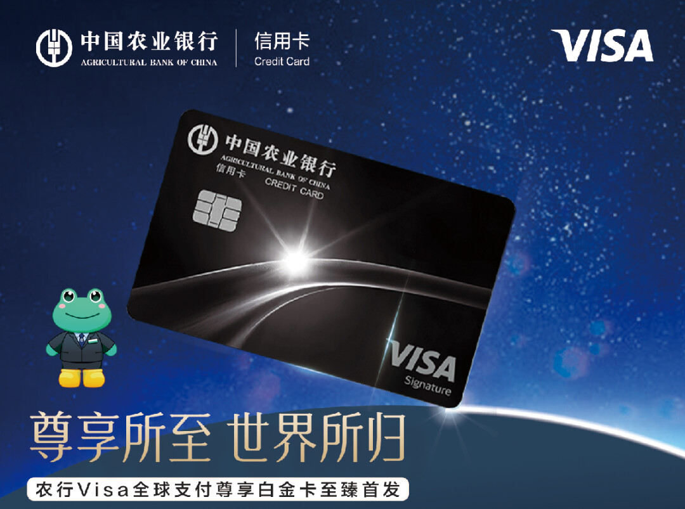

推荐：农行 VISA 全球支付尊享白金卡

既然都说到信用卡了，推荐一下这张农行的信用卡。卡片有每天一次的境外机场贵宾厅权益，还算不错，但最重要的是它免年费。办了之后就再也不用管它，用的时候打个电话预约休息室就行，体验非常省心。转机时有个能洗澡或睡觉的休息室比想象中更重要。如果有境外机场贵宾厅需求，那么我非常推荐你办一张。

### 8. AI 智能体平台

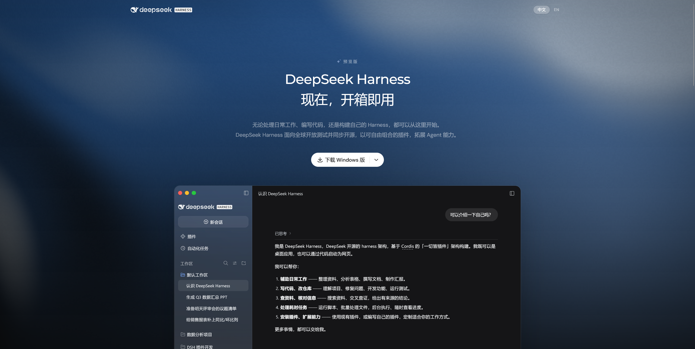

推荐：Deepseek Harness / WorkBuddy / Qoder / Trae 等类似物

老实说我在归类的时候遇到了巨大的困难，它们有的叫自己“AI 办公智能体”，有的叫自己“Harness”，有的叫自己“智能体工作台”，在这里我就不把智能体、Harness 等具体的定义展开说了。总之到了 2026 年，你一定得想办法了解并利用 AI。可以拿来办公，也可以拿来编程，或是处理生活上的事务，它可以把个人能力放大到历史上任何一个时候都难以想象的地步。同时，思考这件事反而更加重要，“怎么想”第一次重于“怎么做”。

如果你囊中羞涩，可以在以上我提到的几个平台中反复横跳，领免费积分。再加上 Opencode 的免费模型、Zcode 不定期的赛博鸡蛋、其他各平台的限免模型等，在短期内不会增加什么支出，却能极大地扩展个人能力边界。

~~当你对这些都有了一定理解之后，就可以准备被 A➗封号了。。。~~

## 不推荐

### 1. 小米金沙江 10000mAh 无线充电宝

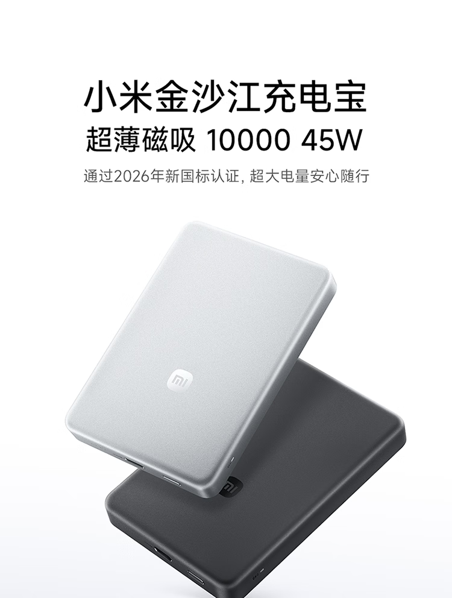

不推荐：小米金沙江 10000mAh 无线充电宝 参考价格：280 元

买它之前，我是有一个酷态科 15 号 20000mAh 充电宝的，但那个实在太大、太重，只有给笔记本补电的时候才好用。于是我看上了小米的这两款（五千和一万）金沙江无线充电宝。对比之下，觉得 5000mAh 都充不满一次手机，还是选择了 10000mAh 的这款。

到手之后才发现自己想错了，大多数情况下轻薄充电宝就是用来应急的，充个百分之二三十就已足够，我根本没有用到 10000mAh 容量的需求。而这款充电宝的重量和厚度都明显超出了我的接受程度，磁吸在手机背后很难维持单手握持姿势。再者无线充电虽然还算快，但发热量也比较夸张，在我的小米 15 上甚至会因过热而停止无线充电。如果不用无线磁吸充电，那还不如一般的自带线充电宝更加方便。

不过反过来说，如果你需要的是一款厚度重量容量都比较中庸的全能产品，这款还是不错的。

### 2. Xiaomi Mimo 系列大模型

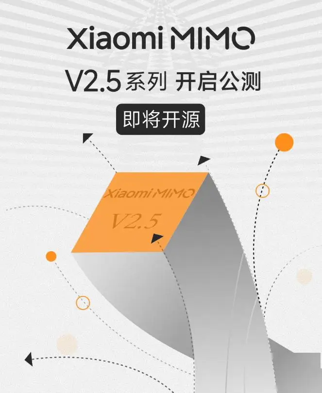

不推荐：Xiaomi Mimo 系列大模型

今年早些时候，Xiaomi Mimo-V2.5 系列发布了，我也是第一时间试了 Mimo Code 以及其中限时免费的 Mimo-V2.5 flash 模型......

然后它就给我删库了。

虽然我有备份，损失不算大，但还是震撼到我了。我原以为删库这件事是古早模型才能干出来的，没想到在我身上出现了。随后，也就一个月前，Xiaomi Mimo-V2.6 系列发布了，我又是第一时间去薅了免费的 Mimo-V2.6 flash 模型......

然后它跑了一百多个 `npm run build` 给我电脑干卡死了。

虽然后来官方发现了这个问题也给出了修复公告，但这还是让我对其产生了深深的怀疑。你说它便宜吧确实算是比较便宜，但这实在是太不稳定。我为什么不选用能力远在其之上且价格达到帕累托最优的 Deepseek 呢？

### 3. 绝大部分 2026 年的数码新品

注：图片由 AI 生成，不知道为啥我让生成数码产品的图片它这么喜欢苹果...

不推荐：绝大部分 2026 年的数码新品

由于众所周知的原因，内存、显卡等价格对比之前暴涨了很多倍，这直接反映在我们常见的数码产品上。去年双十一你可以 8000 块买到 5070 Ti 游戏本，今年 8000 块买个 5060 游戏本用着三年前的 i5 处理器与 QLC 硬盘还得直呼好价。手机、平板、显卡等等全部受到了巨大的冲击。如果你手上的设备需要更新换代，那么我建议尽快购买上代或上上代还有库存的低价产品顶上；如果你眼馋新品，那我建议除非富可敌国否则就苟着吧，涨价潮直接奔着 28、29 年去了。

### 4. 水月雨 GM01 无线游戏耳机

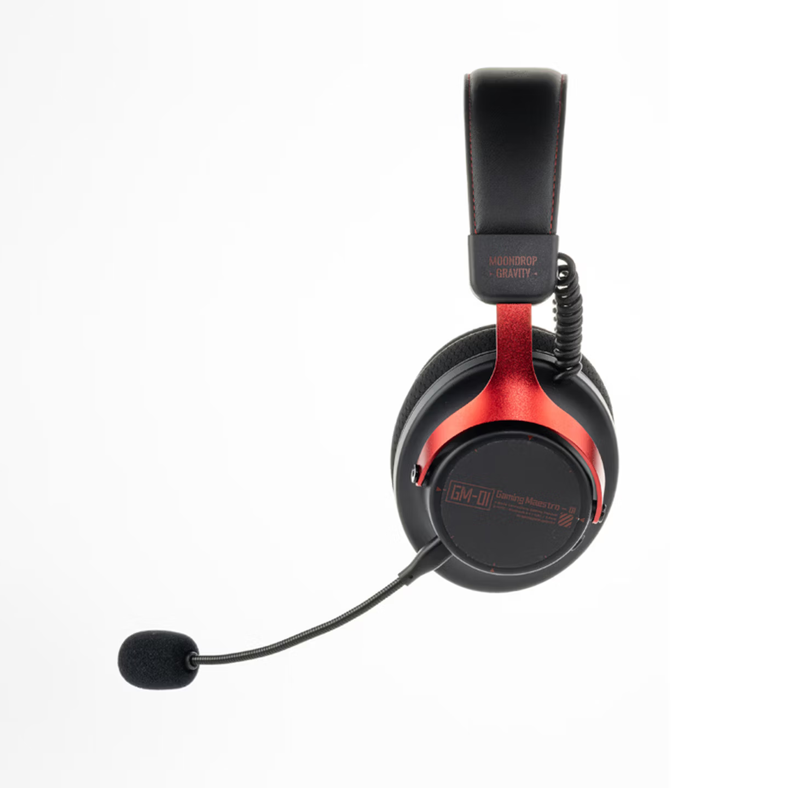

不推荐：水月雨 GM01 无线游戏耳机。参考价格：155 元。

基于之前水月雨兰的良好体验，我还是挺喜欢这个品牌的。在我手上的游戏用耳机坏掉后，我第一时间想起并购买的就是刚出的水月雨 GM01 游戏耳机，但到手还是大失所望。

首先音质远远不及预期，不过本来它就只是个 200 块的东西，买之前我就没考虑音质这个方面。但最让我不能忍的是它有吞字现象。具体问题是当你在游戏中按键发言，或者使用语音输入法按键发言时，它会吞掉前半秒左右的内容。当守望先锋团战打得最激烈时，按键沟通却要等半秒才能传递信息，这种体验是我不可忍受的。由于我没用过其他无线游戏耳机，我不确定这是不是通病，但我很确定这个耳机没法满足我的需求。

### 5. 《明日方舟：终末地》根脉奇境活动

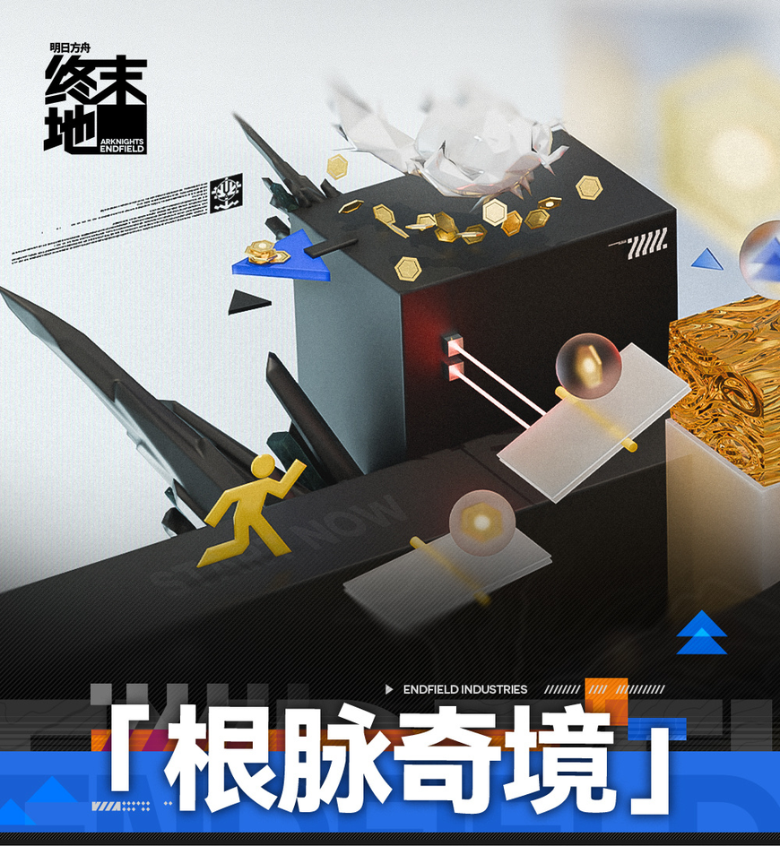

不推荐：《明日方舟：终末地》根脉奇境活动

如果要用一个词来描述终末地的根脉奇境活动，那一定是「赤石」。我完全有理由相信这个活动是被米哈游扫地出门的策划做出来的玩意儿。这个活动的主要玩法是跑图吃金币，基本就和原神里那堆自己为很好玩的小游戏一样，而根脉奇境活动一方面给地图设计了一堆路线鼓励你探索，另一方面其时间限制又极其离谱不让你探索。且时间超出限制后后关卡直接结束，漫长的流程要从头再跑，我又不是在玩魔兽世界硬核模式......虽然后来官方立即滑跪调整了计时规则，但这个活动带来的巨大负反馈已经无法消除了。

终末地整体品质除了剧情外大部分还是在线的，角色设计、地图设计、音乐、逼氪程度等我认为都非常棒。而剧情实在是不行，几个角色的个人故事几乎全部做崩，哪怕是对比本家写得最差的几段剧情也是差得没边。前段时间又出了根脉奇境这么一个这么赤石的活动，我想鹰角终于已经成长为一个需要内部整顿的公司了...

### 6. 火绒安全软件

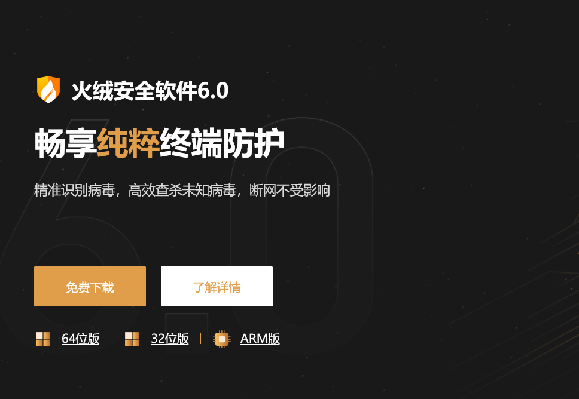

不推荐：火绒安全软件

不推荐火绒是我纠结了一下的。我可以说是火绒多年的忠实用户，且火绒有着不打扰、占用低、便于清理国产流氓等等优点。

直到我偶然间在电脑上发现一个病毒。

那天我突发奇想，让 AI 扫一下启动项看看有没有可优化点。不曾想 AI 列了个可疑项出来，我先拿火绒扫描了一下，没问题。然后不放心丢给了个威胁分析平台，直接报毒。虽然未报毒的也不止火绒一个，我也知道报毒的逻辑，还听过很多“火绒杀毒能力不行”的故事，但这还是极大程度上削弱了我对火绒的信任。

由于感染时间很早，很难再去追溯到底是什么行为感染的病毒。我平时的上网行为应该还算是比较健康的，很少使用来路不正的软件，对假冒钓鱼网址也一直注意着，但还是中毒了。这次查出毒的经历让我决定换卡巴斯基常驻。AI 让网络攻击变得容易很多，安全方面马虎不得。

### 7. 千问输入法

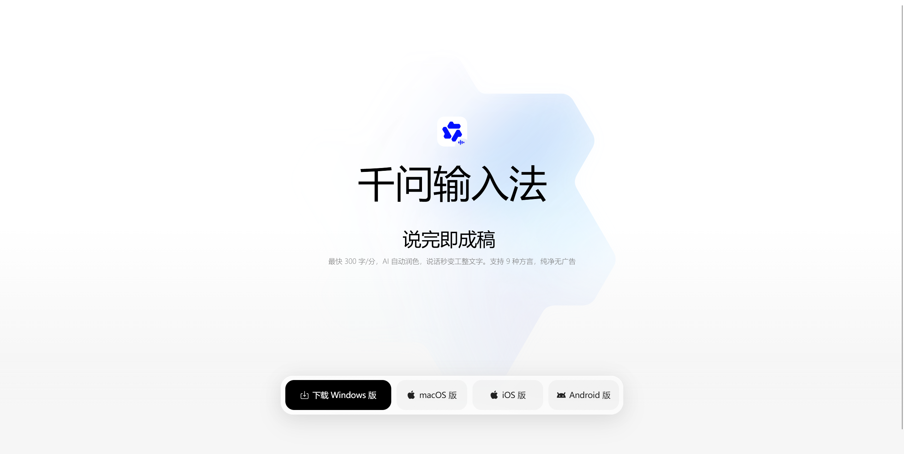

不推荐：千问输入法

输入法这个品类一直不怎么受大厂待见，原因就是商业模式太难。卖数据、加广告的话用户不乐意，卖皮肤又没人买。结果 2026 年 AI 风一吹，厂商反而想起来输入法才是最直接的入口了。市面上接连出现了 微信输入法、Typeless、豆包输入法、千问输入法等产品（注：微信输入法不是赶 AI 风口的，或者说不全是）。它们大多以语音输入、自动整理为核心，部分还有多端同步功能。

其中这个千问输入法实在是令我无法忍受。我很难想象在 2026 年的现在，一个由阿里此等大厂当成正式版发布的软件，顶着千问品牌的鼎鼎大名，居然能在 Windows 和安卓双端下都有严重的卡顿。而且应用细节极其粗糙，功能缺失极其严重（你能想象它连 10 年前的百度输入法都有的剪贴板都没做吗），整个应用像是临时拼凑出来和微信豆包输入法抢市场的。而微信豆包输入法都出来多久了，搜狗百度输入法都出来多久了，真是抄都抄不明白╮(╯▽╰)╭

（后注：千问输入法后来把剪贴板做出来了，但词库云同步、表情面板等诸多功能仍然缺失，仍然不建议使用）

## 结语

之前忘了在哪看到过一个标语，「好好消费，好好生活」。但我想，好好生活，和好好消费并没什么直接的关系。没必要被铺天盖地的节日营销、购物节营销裹挟，只买自己真正需要与喜欢的才是正解。

感谢屏幕前的你有耐心看到现在。虽说写这个年度推荐与不推荐是看到购物节才有的想法，但写着写着又觉得和购物节没什么关系了，更像是我最近生活的随笔，希望以后每年这个时候我都能抽点时间水一篇。那么我们下篇博文再见。
